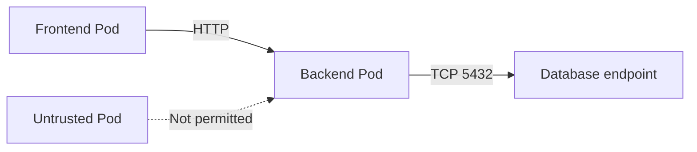
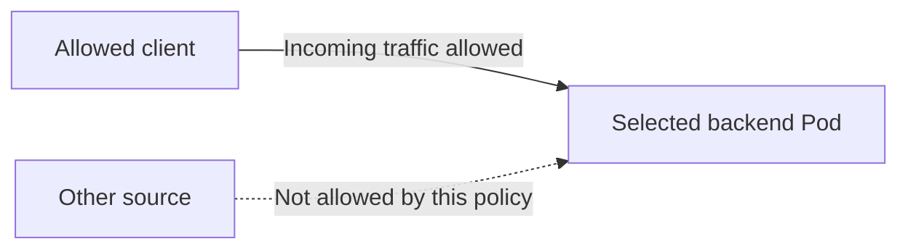
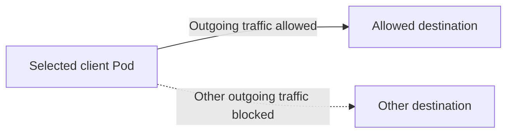
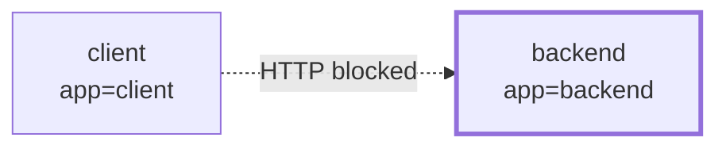
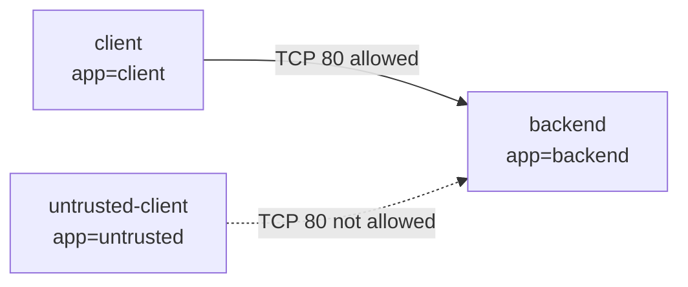
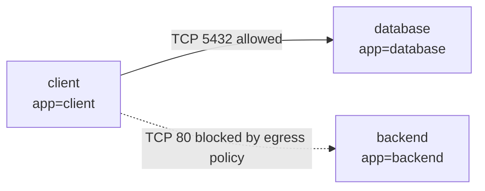
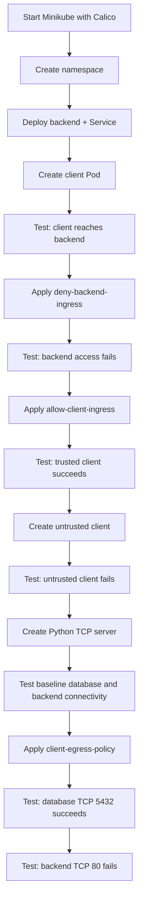

# Kubernetes Network Policies Explained | Complete Hands-On Tutorial with Minikube

Learn how Kubernetes NetworkPolicies control traffic entering and leaving Pods. This hands-on guide uses **Minikube with Calico** to demonstrate ingress restrictions, selectively allowing trusted clients, and restricting egress traffic to a database-like TCP endpoint.

> **Demo note:** The “database” in this tutorial is a lightweight Python TCP server listening on port `5432`. It is not a real PostgreSQL database. The port is used to demonstrate network connectivity.

## What You'll Learn

- What Kubernetes NetworkPolicies do and when they apply.
- The difference between **Ingress** (incoming) and **Egress** (outgoing) traffic.
- How Pod labels and selectors determine which traffic is allowed.
- How to test connectivity before and after applying policies.
- Why multiple NetworkPolicies are additive.
- Why NetworkPolicy enforcement depends on the cluster's CNI plugin.

## How NetworkPolicies Fit Into Pod Communication

Imagine a cluster with a frontend, backend, database, and other workloads. NetworkPolicies let you control which Pods can communicate with selected Pods and on which ports.



A NetworkPolicy controls traffic at the Pod networking level. It is **not** a replacement for authentication or application-level authorization.

## Ingress vs. Egress

NetworkPolicy rules are evaluated from the perspective of the Pod selected by the policy.

### Ingress: traffic entering a selected Pod



### Egress: traffic leaving a selected Pod



For a new connection to succeed, the destination's applicable ingress policies and the source's applicable egress policies must both permit it when those directions are isolated. Return traffic for an allowed connection is permitted by NetworkPolicy connection tracking.

## Prerequisites

- `kubectl`
- Docker
- Minikube
- A CNI plugin that enforces NetworkPolicies

This demo uses **Calico** with Minikube.

## 1. Start Minikube with Calico

Start a Minikube profile named `network-policy-demo`:

```bash
minikube start --driver=docker --cni=calico -p network-policy-demo
```

Switch `kubectl` to this profile and verify the cluster:

```bash
kubectl config use-context network-policy-demo
kubectl get nodes
kubectl get pods -A
```

Wait for the required cluster components to become ready before continuing.

## 2. Create and Set the Demo Namespace

```bash
kubectl create namespace network-policy-demo
kubectl config set-context --current --namespace=network-policy-demo
kubectl config view --minify
```

The commands below assume the current context's default namespace is `network-policy-demo`. The YAML resources also specify `metadata.namespace: network-policy-demo` explicitly, so their target namespace is clear. The namespace must exist before applying these manifests.

> **Context vs. namespace:** `minikube -p network-policy-demo` selects a Minikube profile. `kubectl config set-context --current --namespace=network-policy-demo` sets the default namespace for the current `kubectl` context. They are separate settings.

## 3. Deploy the Backend and Service

Create a file named `backend.yaml`:

```yaml
apiVersion: apps/v1
kind: Deployment
metadata:
  name: backend
  namespace: network-policy-demo
  labels:
    app: backend
spec:
  replicas: 1
  selector:
    matchLabels:
      app: backend
  template:
    metadata:
      labels:
        app: backend
    spec:
      containers:
        - name: nginx
          image: nginx:stable
          ports:
            - containerPort: 80
---
apiVersion: v1
kind: Service
metadata:
  name: backend-service
  namespace: network-policy-demo
spec:
  type: ClusterIP
  selector:
    app: backend
  ports:
    - port: 80
      targetPort: 80
```

Apply the manifest and check the Deployment and Pod:

```bash
kubectl apply -f backend.yaml
kubectl get deployments
kubectl get pods -o wide
```

Wait until the backend Pod is running and ready.

## 4. Create the Trusted Client Pod

```bash
kubectl run client \
  --image=busybox:1.36 \
  --labels=app=client \
  --restart=Never \
  --command -- sh -c "sleep 36000"
```

Check the Pods and their labels:

```bash
kubectl get pods --show-labels
```

At this point, the demo has a backend Pod labelled `app=backend` and a client Pod labelled `app=client`.

## 5. Test Connectivity Before Applying Policies

```bash
kubectl exec client -- wget -qO- http://backend-service
```

You should see the default NGINX welcome page. This confirms that the client can reach the backend through the Service before any NetworkPolicy restricts it.

The Service provides a stable name even if the underlying backend Pod is replaced.

## 6. Deny Ingress Traffic to the Backend

Create `deny-backend-ingress.yaml`:

```yaml
apiVersion: networking.k8s.io/v1
kind: NetworkPolicy
metadata:
  name: deny-backend-ingress
  namespace: network-policy-demo
spec:
  podSelector:
    matchLabels:
      app: backend
  policyTypes:
    - Ingress
  ingress: []
```

Apply and inspect the policy:

```bash
kubectl apply -f deny-backend-ingress.yaml
kubectl get networkpolicies
kubectl describe networkpolicy deny-backend-ingress
```

The policy selects Pods labelled `app=backend`. `policyTypes: [Ingress]` isolates those Pods for incoming traffic, and `ingress: []` provides no ingress allow rules in this policy.

Test again:

```bash
kubectl exec client -- wget -T 3 -qO- http://backend-service
```

The request should fail or time out because no applicable ingress rule currently allows it.



## 7. Allow Ingress from the Trusted Client

Create `allow-client-ingress.yaml`:

```yaml
apiVersion: networking.k8s.io/v1
kind: NetworkPolicy
metadata:
  name: allow-client-ingress
  namespace: network-policy-demo
spec:
  podSelector:
    matchLabels:
      app: backend
  policyTypes:
    - Ingress
  ingress:
    - from:
        - podSelector:
            matchLabels:
              app: client
      ports:
        - protocol: TCP
          port: 80
```

Apply the policy:

```bash
kubectl apply -f allow-client-ingress.yaml
kubectl get networkpolicies
```

The policy selects the backend Pods and allows TCP port `80` from Pods labelled `app=client`. Because there is no `namespaceSelector`, the Pod selector matches Pods in the policy's own namespace.

### Important: NetworkPolicies are additive

The deny policy does not override or cancel the allow policy. When multiple policies select a Pod, the allowed traffic is the combined set of traffic permitted by the applicable policies.



Test the trusted client:

```bash
kubectl exec client -- wget -qO- http://backend-service
```

You should see the NGINX welcome page again.

## 8. Create an Untrusted Client and Test It

```bash
kubectl run untrusted-client \
  --image=busybox:1.36 \
  --labels=app=untrusted \
  --restart=Never \
  --command -- sh -c "sleep 36000"
```

Check the labels:

```bash
kubectl get pods --show-labels
```

Try to access the backend:

```bash
kubectl exec untrusted-client -- wget -T 3 -qO- http://backend-service
```

The request should fail or time out. The allow policy only matches Pods labelled `app=client`; the untrusted Pod has `app=untrusted`.

## 9. Create a Database-Like TCP Server

Now we'll demonstrate egress. Create `database.yaml`:

```yaml
apiVersion: v1
kind: Pod
metadata:
  name: database
  namespace: network-policy-demo
  labels:
    app: database
spec:
  containers:
    - name: database-server
      image: python:3.12-alpine
      command:
        - python
        - -u
        - -c
      args:
        - |
          import socket

          server = socket.socket()
          server.setsockopt(socket.SOL_SOCKET, socket.SO_REUSEADDR, 1)
          server.bind(("0.0.0.0", 5432))
          server.listen()

          print("Demo TCP server listening on port 5432", flush=True)

          while True:
              connection, address = server.accept()
              connection.sendall(b"Database TCP connection successful!\n")
              connection.close()
      ports:
        - containerPort: 5432
          protocol: TCP
```

Apply it and check that it starts:

```bash
kubectl apply -f database.yaml
kubectl get pods -o wide
kubectl logs database
```

Expected log:

```text
Demo TCP server listening on port 5432
```

### What the Python server does

- `socket.socket()` creates a TCP socket.
- `SO_REUSEADDR` allows the local address to be reused when the server restarts.
- `bind(("0.0.0.0", 5432))` listens on port `5432` on all container network interfaces.
- `listen()` prepares the socket to accept connections.
- `accept()` waits for a client connection.
- `sendall()` sends a success message, then the server closes that connection.

The `-u` argument runs Python with unbuffered output so the startup message appears promptly in the logs. `containerPort` documents the port; it does not itself create a firewall rule or publish the port outside the cluster.

## 10. Test Connectivity Before Applying Egress Rules

Get the database and backend Pod IPs:

```bash
DB_IP=$(kubectl get pod database -o jsonpath='{.status.podIP}')
BACKEND_IP=$(kubectl get pods -l app=backend -o jsonpath='{.items[0].status.podIP}')

echo "Database IP: $DB_IP"
echo "Backend IP: $BACKEND_IP"
```

> Run these commands and the following tests in the **same local terminal session**, because the shell variables are stored locally.

Test the database-like endpoint:

```bash
kubectl exec client -- nc -w 3 "$DB_IP" 5432
```

Expected output:

```text
Database TCP connection successful!
```

Test direct access to the backend Pod:

```bash
kubectl exec client -- wget -T 3 -qO- "http://$BACKEND_IP"
```

You should see the NGINX welcome page. Both connections should work before the egress policy is applied.

## 11. Restrict the Client's Egress Traffic

Create `client-egress-policy.yaml`:

```yaml
apiVersion: networking.k8s.io/v1
kind: NetworkPolicy
metadata:
  name: client-egress-policy
  namespace: network-policy-demo
spec:
  podSelector:
    matchLabels:
      app: client
  policyTypes:
    - Egress
  egress:
    - to:
        - podSelector:
            matchLabels:
              app: database
      ports:
        - protocol: TCP
          port: 5432
```

Apply the policy:

```bash
kubectl apply -f client-egress-policy.yaml
kubectl get networkpolicies
kubectl describe networkpolicy client-egress-policy
```

This policy selects Pods labelled `app=client` and isolates them for outgoing traffic. It allows TCP traffic to Pods labelled `app=database` on port `5432`. Because there is no `namespaceSelector`, the destination Pod selector matches Pods in the same namespace.

The policy does not allow arbitrary outgoing traffic.



## 12. Verify Allowed and Blocked Egress

The database connection should still work:

```bash
kubectl exec client -- nc -w 3 "$DB_IP" 5432
```

Expected output:

```text
Database TCP connection successful!
```

Now try the backend again:

```bash
kubectl exec client -- wget -T 3 -qO- "http://$BACKEND_IP" \
  || echo "Connection blocked as expected"
```

The backend request should fail or time out and print:

```text
Connection blocked as expected
```

Why? The backend's ingress policy allows incoming TCP traffic from `app=client` on port `80`, but the client's egress policy only permits traffic to Pods labelled `app=database` on TCP port `5432`. The destination's ingress permission does not override the source's egress restriction.

> **Why use Pod IPs for these egress tests?** The test avoids relying on DNS after egress isolation is enabled. This policy does not include a rule to allow DNS traffic.

## Full Demo Flow at a Glance



## Troubleshooting

### A connection still succeeds after applying a deny policy

- Confirm the policy selects the intended Pod labels.
- Confirm you applied the policy to the intended namespace.
- Check the Pod labels with `kubectl get pods --show-labels`.
- Verify that the CNI plugin supports and enforces NetworkPolicies.

### The trusted client cannot reach the backend

```bash
kubectl get pods --show-labels
kubectl get networkpolicies
kubectl describe networkpolicy allow-client-ingress
kubectl get endpoints backend-service
```

Check that the backend Pod has `app=backend`, the trusted client has `app=client`, and the backend Service has an endpoint.

### The database TCP test fails

```bash
kubectl get pod database -o wide
kubectl logs database
```

Wait for the database Pod to be running and verify that the server startup message appears.

### Remember

- A NetworkPolicy only affects Pods selected by its `podSelector`.
- Ingress and egress isolation are independent.
- Multiple NetworkPolicies are additive.
- Selectors without a `namespaceSelector` match Pods in the policy's own namespace.
- A Pod must be isolated in the relevant direction before policies restrict that direction.
- NetworkPolicy enforcement depends on the CNI plugin.
- Labels and selectors are central to deciding which traffic is allowed.

## Cleanup

Delete the namespace and its namespaced demo resources:

```bash
kubectl delete namespace network-policy-demo
```

If you also want to remove the Minikube profile created for this tutorial, run:

```bash
minikube delete -p network-policy-demo
```

The second command deletes the Minikube profile itself, so use it only if you no longer need that cluster.

---

**Video companion:** This README is intended as a practical companion to the tutorial. Follow the sections in order and run each connectivity test before and after applying the corresponding policy to observe the difference.
